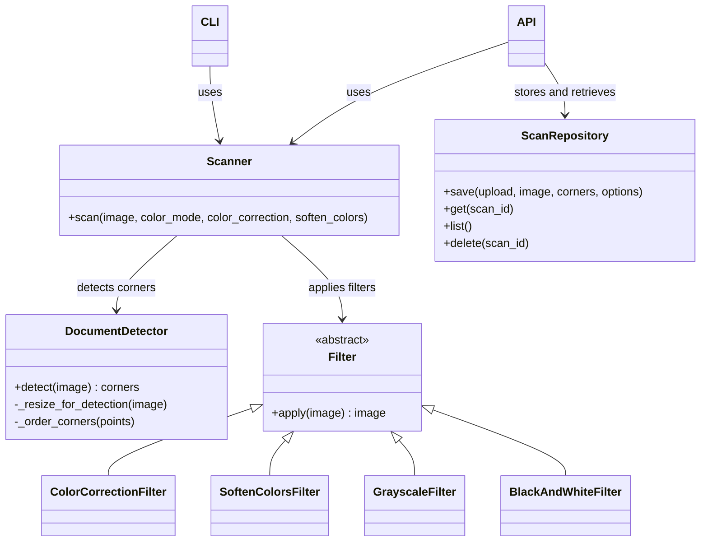

# TP 2 — Escáner de documentos

Aplicación web y herramienta de línea de comandos para detectar una hoja en una
fotografía, corregir su perspectiva y mejorar el resultado con filtros.

La consigna completa está en [`enunciado.html`](enunciado.html).

## Integrantes
Griselda Blanco
Fernanda Fava
Ignacio Toto

## Requisitos

- Python 3.14 o una versión compatible con las dependencias del proyecto.
- Las dependencias listadas en [`backend/requirements.txt`](backend/requirements.txt).

## Instalación y ejecución

En Windows, desde PowerShell:

```powershell
cd backend
python -m venv .venv
.\.venv\Scripts\Activate.ps1
pip install -r requirements.txt
uvicorn app.main:app --reload --port 8765
```

En macOS o Linux, activá el entorno con `source .venv/bin/activate`.

- Aplicación web: <http://localhost:8765>
- Documentación interactiva de la API: <http://localhost:8765/docs>
- Estado del servidor: <http://localhost:8765/api/health>

## Uso desde la línea de comandos

Desde `backend`, la CLI lee una foto y guarda el resultado como PNG:

```powershell
python -m docscan foto.jpg escaneo.png
```

Opciones disponibles:

```powershell
python -m docscan foto.jpg escaneo.png --color-mode grayscale --soften-colors 0.5
python -m docscan foto.jpg escaneo-bw.png --color-mode bw --no-color-correction
```

- `--color-mode`: `color` (por defecto), `grayscale` o `bw`.
- `--no-color-correction`: desactiva la corrección de dominante de color.
- `--soften-colors`: intensidad entre `0` y `1` para aclarar colores fuertes.

Si no se puede abrir la foto o no se detecta un documento, la CLI informa el
error por la salida de error y termina con un código distinto de cero.

## API

| Método y ruta | Función |
| --- | --- |
| `GET /api/health` | Estado del servidor. |
| `POST /api/detect` | Devuelve el ancho, alto y las cuatro esquinas detectadas; no guarda archivos. |
| `POST /api/scans` | Procesa una foto con las opciones enviadas y guarda el resultado y el original. |
| `GET /api/scans` | Lista los escaneos, del más nuevo al más viejo. |
| `GET /api/scans/{scan_id}` | Devuelve los metadatos de un escaneo guardado. |
| `DELETE /api/scans/{scan_id}` | Elimina el escaneo, la foto original y los metadatos. |

En `POST /api/scans`, las opciones son campos del formulario:

- `color_mode`: `color`, `grayscale` o `bw`.
- `color_correction`: booleano, activado por defecto.
- `soften_colors`: número de `0` a `1`, por defecto `0`.

La API valida las imágenes subidas y traduce las excepciones del core a
respuestas HTTP con un código y un mensaje explicativo.

## Arquitectura del core

El paquete `docscan` procesa arreglos NumPy de OpenCV en orden BGR y no depende
de FastAPI. `read_photo` aplica la orientación EXIF y prepara la imagen; el
escáner detecta el documento, corrige la perspectiva y aplica los filtros
elegidos. La API y la CLI reutilizan ese mismo core.



### Decisiones de procesamiento

1. **Detección:** se reduce la imagen manteniendo su proporción (máximo
   predeterminado de 600 píxeles en el lado mayor), se pasa a escala de grises,
   se suaviza con Gaussian blur y se detectan bordes con Canny. Un cierre
   morfológico une bordes cercanos. Se examinan los contornos de mayor área y
   se acepta el primer cuadrilátero convexo con área de al menos el 15 % de la
   imagen. `approxPolyDP` aproxima cada contorno con una tolerancia del 2 % de
   su perímetro. Las esquinas se devuelven en orden horario: superior
   izquierda, superior derecha, inferior derecha, inferior izquierda. Si no
   aparece un candidato válido, se lanza `DocumentNotFound`.
2. **Perspectiva:** se calcula el ancho a partir del mayor de los lados
   superior e inferior y la altura a partir del mayor de los lados izquierdo y
   derecho. `getPerspectiveTransform` y `warpPerspective` llevan las cuatro
   esquinas a un rectángulo sin invertir el orden.
3. **Filtros polimórficos:** cada filtro implementa `Filter.apply(image)`.
   `Scanner` prepara la secuencia según las opciones y la recorre aplicando la
   misma interfaz. La corrección de color estima el papel mediante el
   percentil 98 por canal; el suavizado trabaja con saturación y brillo en HSV;
   los modos gris y blanco y negro convierten el resultado al final.
4. **Responsabilidades separadas:** `DocumentDetector` detecta, la función de
   perspectiva endereza, los filtros mejoran la imagen y `ScanRepository`
   persiste archivos. La API no implementa procesamiento de píxeles y el core
   no importa la API.
5. **Almacenamiento:** cada escaneo usa un identificador generado por el
   backend y se guarda como PNG, foto original sin modificar y JSON de
   metadatos dentro de `STORAGE_DIR`. El listado se ordena por fecha de
   creación descendente.

## Tests

Desde `backend`, ejecutá la suite de aceptación:

```powershell
python -m pytest tests/test_contract.py -v
```

Resultado verificado durante el desarrollo: **79 passed**.

## Ejemplo antes y después

Agregar al repositorio una foto propia de un documento y el escaneo resultante
`docs/images/antes.jpg` y `docs/images/despues.png`, y luego reemplazar
esta nota por las imágenes:

```text
Pendiente: incorporar aquí las imágenes reales antes/después del escaneo.
```

## Archivos locales

No subir al repositorio el entorno virtual `.venv/` ni los escaneos generados
en `backend/storage/`.
