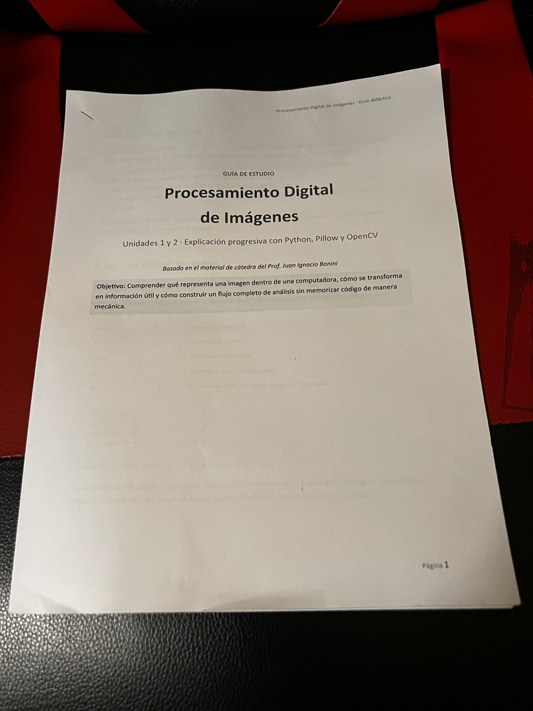
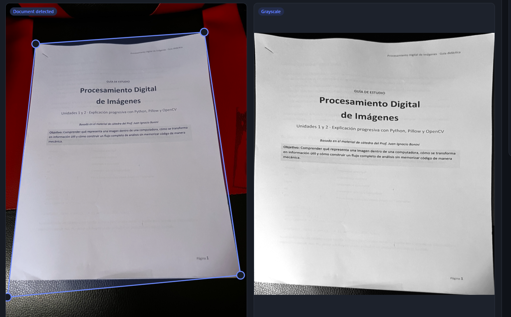
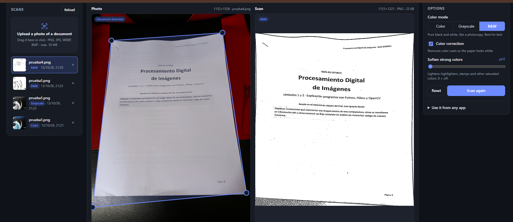
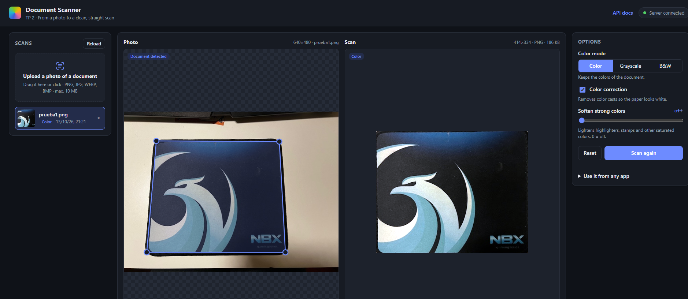
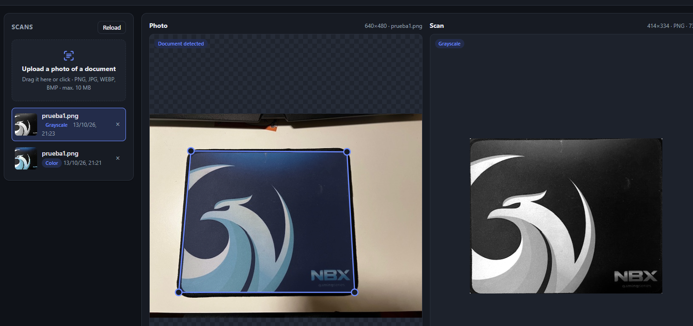
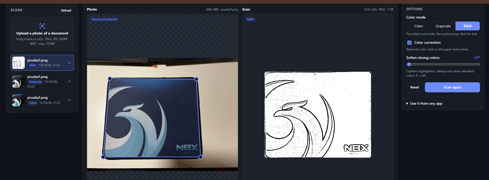

# Evidencias de pruebas con fotografías reales — TP 2

Estas imágenes documentan pruebas manuales realizadas desde la interfaz web del escáner de documentos. Las capturas muestran el panel de detección (esquinas marcadas) y el resultado del procesamiento; **no** son exportaciones PNG del escaneo aislado.

## Caso 1: hoja con texto sobre fondo contrastante

**Entrada:** hoja fotografiada en perspectiva, con texto de distintos tamaños, bordes visibles y ligera curvatura física del papel.

**Escala de grises:** la perspectiva se rectifica y el contenido principal se mantiene legible; se aprecia una franja del fondo en el margen inferior, asociada a la detección imprecisa de una esquina.

**Blanco y negro:** el filtro produce una imagen binaria, pero los detalles finos pierden legibilidad y aparecen artefactos en ciertas zonas.

## Caso 2: mouse pad sobre escritorio claro

Objeto cuadrilateral con contraste respecto del fondo, utilizado para comprobar detección de cuatro esquinas y transformación de perspectiva. **Es una prueba geométrica**, no una prueba de legibilidad documental.

**Color:**

**Escala de grises:**

**Blanco y negro:** la textura oscura del objeto genera bastante ruido, lo que demuestra que este filtro resulta más apropiado para papel con texto que para superficies texturadas.

## Conclusiones y límites

- Se observó detección de cuatro esquinas, corrección de perspectiva, recorte y generación de versiones en distintos modos.
- Una detección imprecisa puede incorporar parte del fondo, especialmente junto a los bordes de documentos curvados.
- La homografía rectifica el plano aproximado del documento, pero no aplana curvaturas físicas del papel.
- La umbralización adaptativa puede introducir ruido en texturas y perder detalle fino.
- Los resultados se evaluaron visualmente. Estas capturas no constituyen una evaluación cuantitativa de precisión ni sustituyen los tests automatizados.

**Validación automatizada complementaria:** 79 tests de aceptación y 14 tests propios aprobaron juntos (93 passed), según la ejecución local del equipo.
