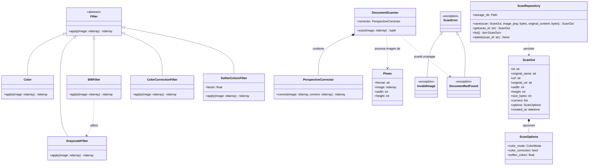

# Diagrama UML — TP 2: Escáner de documentos

Este diagrama representa las clases principales implementadas en el núcleo de procesamiento (`docscan`) y en la capa de API y persistencia (`app`). Se omiten funciones auxiliares para facilitar la lectura.

## Flujo de procesamiento

1. `read_photo` interpreta la imagen de entrada y aplica la orientación EXIF cuando corresponde.
2. `detect_document` localiza un cuadrilátero y devuelve las cuatro esquinas en orden.
3. `DocumentScanner` usa `PerspectiveCorrector` para rectificar la región detectada.
4. La API o la CLI aplica los filtros elegidos: corrección de color, suavizado y modo final (`Color`, `GrayscaleFilter` o `BWFilter`).
5. `encode_png` convierte la imagen procesada a PNG. En la API, `ScanRepository` guarda el PNG, el original y los metadatos JSON.

**Alcance del diagrama:** `detect_document`, `read_photo` y `encode_png` son funciones, no clases. Los filtros se aplican actualmente desde la API y la CLI, y no desde `DocumentScanner`. Se representan las dependencias principales, no todas las llamadas internas.
